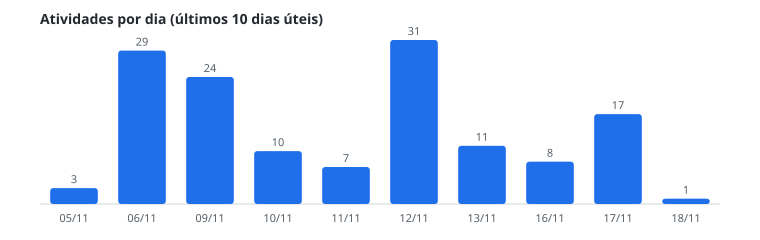
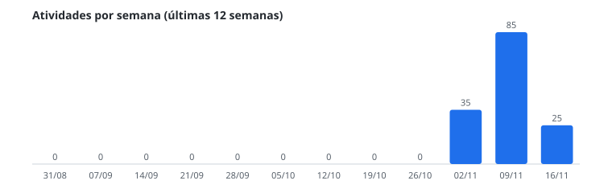

## Produtividade

Números agregados de todos os repositórios da organização, atualizados automaticamente todos os dias.
**Última atualização:** <!--ATUALIZADO:INICIO-->26/11/2026<!--ATUALIZADO:FIM-->

### Resumo da semana

<!--SEMANA:INICIO-->
| Métrica | Esta semana | Semana passada | Variação |
|---|---|---|---|
| Commits | 97 | 58 | +67% |
| Issues abertas | 21 | 0 | novo |
| Issues fechadas | 17 | 0 | novo |
| **Total de atividades** | 135 | 58 | +133% |
| Repositórios com commits | 2 | 2 | +0% |
<!--SEMANA:FIM-->

### Dia a dia (últimos 10 dias úteis)

<!--DIARIO:INICIO-->
| Dia | Commits | Issues abertas | Issues fechadas | Total |
|---|---|---|---|---|
| qua 25/11 | 42 | 0 | 4 | 46 |
| ter 24/11 | 27 | 13 | 7 | 47 |
| seg 23/11 | 12 | 8 | 6 | 26 |
| sex 20/11 | 11 | 0 | 0 | 11 |
| qui 19/11 | 9 | 0 | 0 | 9 |
| qua 18/11 | 11 | 0 | 0 | 11 |
| ter 17/11 | 17 | 0 | 0 | 17 |
| seg 16/11 | 8 | 0 | 0 | 8 |
| sex 13/11 | 9 | 0 | 2 | 11 |
| qui 12/11 | 16 | 12 | 3 | 31 |
<!--DIARIO:FIM-->

### Semana a semana (últimas 12 semanas)

<!--SEMANAL:INICIO-->
| Semana | Commits | Issues abertas | Issues fechadas | Total |
|---|---|---|---|---|
| Semana de 23/11 | 97 | 21 | 17 | 135 |
| Semana de 16/11 | 58 | 0 | 0 | 58 |
| Semana de 09/11 | 41 | 26 | 18 | 85 |
| Semana de 02/11 | 19 | 8 | 8 | 35 |
| Semana de 26/10 | 0 | 0 | 0 | 0 |
| Semana de 19/10 | 0 | 0 | 0 | 0 |
| Semana de 12/10 | 0 | 0 | 0 | 0 |
| Semana de 05/10 | 0 | 0 | 0 | 0 |
| Semana de 28/09 | 0 | 0 | 0 | 0 |
| Semana de 21/09 | 0 | 0 | 0 | 0 |
| Semana de 14/09 | 0 | 0 | 0 | 0 |
| Semana de 07/09 | 0 | 0 | 0 | 0 |
<!--SEMANAL:FIM-->

### Linguagens mais usadas

<!--LINGUAGENS:INICIO-->
| Linguagem | Participação nos commits (12 semanas) |
|---|---|
| Python | 100% |
<!--LINGUAGENS:FIM-->

_São contagens agregadas de commits, pull requests, revisões e issues. Nomes de repositórios, pessoas e itens privados não são exibidos._
