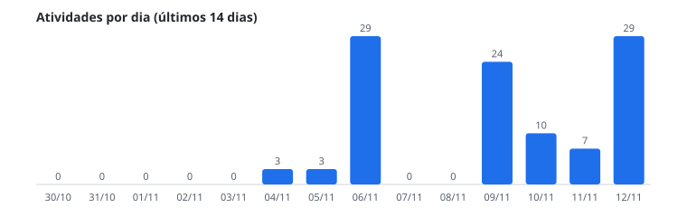
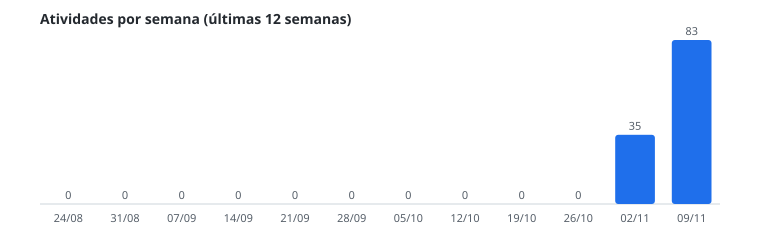

## Produtividade da equipe

Números agregados de todos os repositórios da organização, atualizados automaticamente todos os dias.
**Última atualização:** <!--ATUALIZADO:INICIO-->12/11/2026<!--ATUALIZADO:FIM-->

### Resumo da semana

<!--SEMANA:INICIO-->
| Métrica | Esta semana | Semana passada | Variação |
|---|---|---|---|
| Commits | 7 | 4 | +75% |
| PRs abertos | 0 | 0 | — |
| PRs mesclados | 0 | 0 | — |
| Revisões | 0 | 0 | — |
| Issues abertas | 0 | 0 | — |
| Issues fechadas | 0 | 0 | — |
| **Total de atividades** | 7 | 4 | +75% |
| Repositórios com commits | 1 | 1 | +0% |
<!--SEMANA:FIM-->

### Dia a dia (últimos 14 dias)

<!--DIARIO:INICIO-->
| Dia | Commits | PRs abertos | PRs mesclados | Revisões | Issues abertas | Issues fechadas | Total |
|---|---|---|---|---|---|---|---|
| qui 12/11 | 7 | 0 | 0 | 0 | 0 | 0 | 7 |
| qua 11/11 | 0 | 0 | 0 | 0 | 0 | 0 | 0 |
| ter 10/11 | 0 | 0 | 0 | 0 | 0 | 0 | 0 |
| seg 09/11 | 0 | 0 | 0 | 0 | 0 | 0 | 0 |
| dom 08/11 | 0 | 0 | 0 | 0 | 0 | 0 | 0 |
| sáb 07/11 | 0 | 0 | 0 | 0 | 0 | 0 | 0 |
| sex 06/11 | 0 | 0 | 0 | 0 | 0 | 0 | 0 |
| qui 05/11 | 1 | 0 | 0 | 0 | 0 | 0 | 1 |
| qua 04/11 | 3 | 0 | 0 | 0 | 0 | 0 | 3 |
| ter 03/11 | 0 | 0 | 0 | 0 | 0 | 0 | 0 |
| seg 02/11 | 0 | 0 | 0 | 0 | 0 | 0 | 0 |
| dom 01/11 | 0 | 0 | 0 | 0 | 0 | 0 | 0 |
| sáb 31/10 | 0 | 0 | 0 | 0 | 0 | 0 | 0 |
| sex 30/10 | 0 | 0 | 0 | 0 | 0 | 0 | 0 |
<!--DIARIO:FIM-->

### Semana a semana (últimas 12 semanas)

<!--SEMANAL:INICIO-->
| Semana | Commits | PRs abertos | PRs mesclados | Revisões | Issues abertas | Issues fechadas | Total |
|---|---|---|---|---|---|---|---|
| Semana de 09/11 | 7 | 0 | 0 | 0 | 0 | 0 | 7 |
| Semana de 02/11 | 4 | 0 | 0 | 0 | 0 | 0 | 4 |
| Semana de 26/10 | 0 | 0 | 0 | 0 | 0 | 0 | 0 |
| Semana de 19/10 | 0 | 0 | 0 | 0 | 0 | 0 | 0 |
| Semana de 12/10 | 0 | 0 | 0 | 0 | 0 | 0 | 0 |
| Semana de 05/10 | 0 | 0 | 0 | 0 | 0 | 0 | 0 |
| Semana de 28/09 | 0 | 0 | 0 | 0 | 0 | 0 | 0 |
| Semana de 21/09 | 0 | 0 | 0 | 0 | 0 | 0 | 0 |
| Semana de 14/09 | 0 | 0 | 0 | 0 | 0 | 0 | 0 |
| Semana de 07/09 | 0 | 0 | 0 | 0 | 0 | 0 | 0 |
| Semana de 31/08 | 0 | 0 | 0 | 0 | 0 | 0 | 0 |
| Semana de 24/08 | 0 | 0 | 0 | 0 | 0 | 0 | 0 |
<!--SEMANAL:FIM-->

### Linguagens mais usadas

<!--LINGUAGENS:INICIO-->
| Linguagem | Participação nos commits (12 semanas) |
|---|---|
| Python | 100% |
<!--LINGUAGENS:FIM-->

_São contagens agregadas de commits, pull requests, revisões e issues. Nomes de repositórios, pessoas e itens privados não são exibidos._
